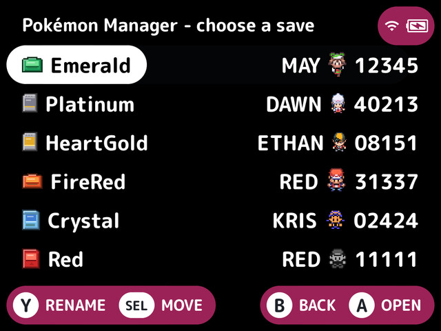
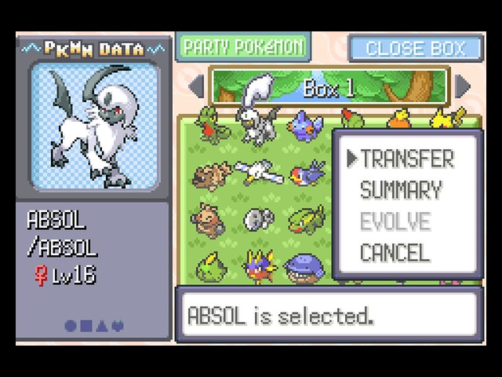
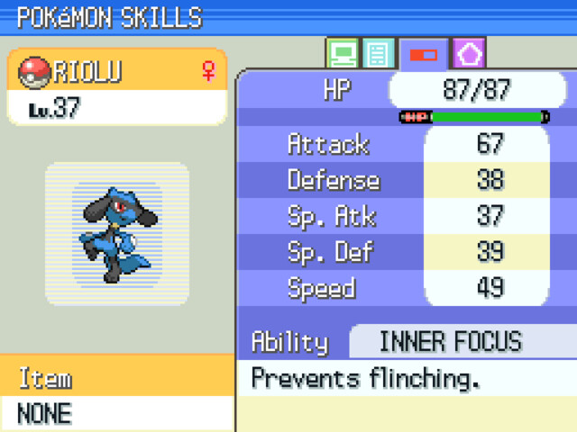

# Pokémon Manager for NextUI

A tool pak for NextUI handhelds that lets you manage your Pokémon save files right on the device. It's built on [PKHeX](https://github.com/kwsch/PKHeX).

  
  
  

## What it does

- **Move Pokémon between your games**, from Red/Blue up to Black 2/White 2. By default it follows the same rules as trading in the real games.
- **Trade evolutions without a second console.** Evolve Kadabra, Haunter, Onix with a Metal Coat and so on. Karrablast and Shelmet can be traded for each other between two of your Gen 5 saves.
- **Mystery Gifts and events.** Get the event tickets (Eon Ticket, Aurora Ticket, Member Card…) and you collect them in-game, like the real thing. Gold/Silver/Crystal also get their daily Mystery Gift items and decorations.
- **Event Pokémon.** A Distributions menu offers the event-only Pokémon your game can't get any other way, generated fresh for your save. The full Project Pokémon [Events Gallery](https://github.com/projectpokemon/EventsGallery) is built in too.
- **Your game's own PC.** Browse your boxes on a PC screen drawn like the game's, with its summary pages, sprites and fonts.
- **Clock and Trainer Card.** Set the in-game clock for Gold/Silver/Crystal and Ruby/Sapphire/Emerald, and view your Trainer Card.
- **Automatic backups** before every change, in `PokemonManager/Backups`: the last 32 saves and 32 save states for each game.

Each event shows whether it's **✅ Legal** or **☠️ Illegal** according to PKHeX's legality check.

## Installation

1. Download the zip for your device from the [Releases](../../releases) page:

   | Device | File |
   | --- | --- |
   | Anbernic H700 devices (RG35XX Plus/H/SP/2024, RG40XX, RG CubeXX, RG34XX…) | `PokemonManager-h700-sdcard.zip` |
   | TrimUI Brick, TrimUI Smart Pro | `PokemonManager-tg5040-sdcard.zip` |
   | TrimUI Smart Pro S | `PokemonManager-tg5050-sdcard.zip` |
   | Miyoo Flip | `PokemonManager-my355-sdcard.zip` |

2. Unzip it onto the root of your SD card.
3. Open **Tools → Pokemon Manager**.

The pak checks for updates when it starts if Wi-Fi is on, and you can check yourself from **Update** on the main menu.

## Using it

Your saves are listed with the most recently played first. Pick one to open its menu, where you can browse its Pokémon, collect gifts, or set its clock.

A save only shows up when:

- its game's ROM is on the SD card, with the same name as the save, and
- the game has got as far as receiving the Pokédex.

Saves from ROM hacks, translations and other modified ROMs go in a separate **Others** list. They can be opened, but Pokémon aren't moved to them, because editing a hack as if it were the original game can corrupt it.

## ⚠️ Before you start

- **Close the game before editing, and start it fresh afterwards, not from a save state or auto-resume.** A save state still has the old save in memory and will write it back over your changes. When the pak changes a save, it moves that game's save state into the save's backup folder, so it can't be resumed by mistake.
- **Keep your own backup** of any save you care about. The pak backs up every save before changing it, but this is still a beta.

**Status:** public beta. Tested on the Anbernic RG35XX SP and the TrimUI Brick. Other devices should work but haven't been tried. Please [report problems](https://github.com/ProClifo/NextUI-Pokemon-Manager/issues/new?template=bug_report.yml) with your device, game, language and pak version.

## More details

- [Features in detail](docs/features.md): every menu, the PC view, Legal/Illegal, settings
- [Transfer rules](docs/transfers.md): what each game needs before it can trade
- [Gen 3 events](docs/gen3-events.md): Wonder Cards, Mystery Events and e-Reader files
- [Development](docs/development.md): building the pak, command line, how it works

## Credits

- [PKHeX](https://github.com/kwsch/PKHeX) by Kaphotics and contributors
- [NextUI](https://github.com/LoveRetro/NextUI), and [minui-list / minui-presenter](https://github.com/josegonzalez) by Jose Diaz-Gonzalez
- [Project Pokémon's EventsGallery](https://github.com/projectpokemon/EventsGallery) for the event files
- The [pret](https://github.com/pret) decompilations, for the game art, fonts and game data
- Gen 5 sprites from [The Spriters Resource](https://www.spriters-resource.com/), box icons ripped by Ploaj, Black/White wallpapers and player sprites ripped by Barubary, Black 2/White 2 player sprites by Dazz and redblueyellow
- The PKHeX WC3 plugin and suloku's Gen III Mystery Gift Tool, for the Gen 3 event formats
- ROM checksums from [No-Intro](https://no-intro.org), and ✅/☠️ icons from Google's [Noto Emoji](https://github.com/googlefonts/noto-emoji)

Pokémon is © Nintendo / Creatures Inc. / GAME FREAK inc. This project is not affiliated with or endorsed by them.

## License

GPL-3.0-or-later, the same as PKHeX. See [LICENSE](LICENSE).
